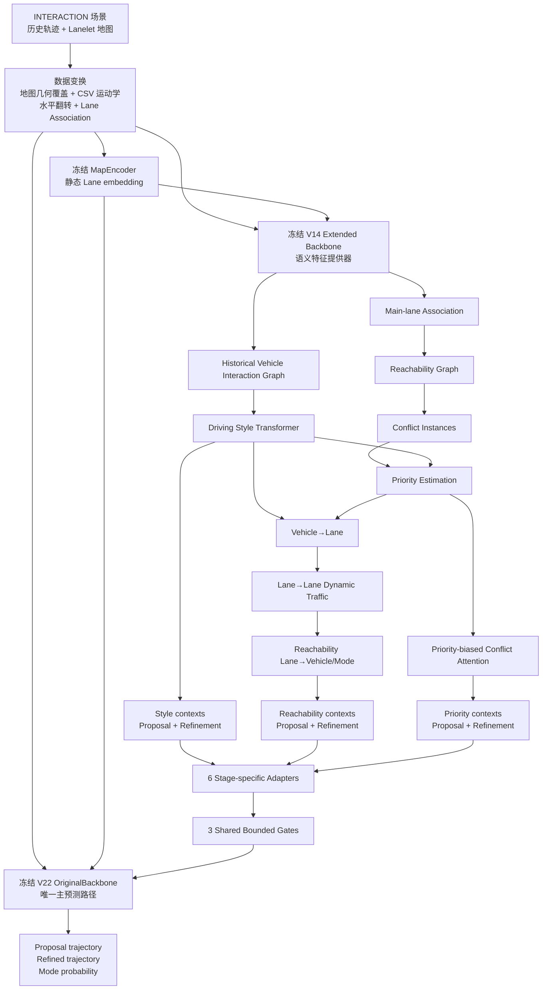

# PNet 最终模型技术说明

> 文档用途：硕士论文撰写  
> 状态日期：2026-08-28  
> 代码依据：`HPNet-INTERACTION/` 当前工作树  
> 最终模型配置：released seed-2048 checkpoint hyperparameters  
> 最终模型检查点：`ntspnet_final_seed2048.ckpt`

本文只描述当前最终采用的 PNet，不把历史实验路线混入正文。代码中虽然仍保留若干历史实验分支，但凡未被 V48 配置和 `original_residual` 前向/训练分支实际使用的内容，均不属于本文所称“最终模型”。历史废弃方案仅在文档最后集中说明。

---

## 1. 当前最终模型的准确定位

当前 PNet 不是把一个扩展模型的轨迹与 HPNet 轨迹进行平均，也不是让新增模块替换 HPNet 主干。其结构是：

1. 以本地重新训练的 HPNet V22 作为冻结的唯一主预测路径；
2. 以包含 Driving Style、Reachability、Priority 和 Conflict-Aware Interaction 的 V14 扩展 Backbone 作为冻结语义特征提供器；
3. 丢弃扩展 Backbone 自己的轨迹与概率输出；
4. 仅提取扩展 Backbone 在 Proposal 和 Refinement 两个阶段形成的 Style、Reachability、Priority 上下文；
5. 每类上下文经过阶段独立的 `LayerNorm + Linear` 适配器；
6. 通过零初始化、绝对值上限为 0.1 的可学习门控，将上下文作为表示级残差注入冻结 V22；
7. 最终仍由 V22 的 Proposal decoder、Refinement decoder 和 probability decoder 产生唯一输出。

因此，模型关系不是“两个预测器并行集成”，而是：

> 冻结 HPNet 主预测路径 + 冻结交通语义侧分支 + 主干内部双阶段表示级残差融合。

当前 V48 训练只更新 6 个适配器和 3 个标量门控，共 100,611 个参数。

---

## 2. 研究任务与输入输出

### 2.1 研究任务

研究任务为 INTERACTION multi-agent 场景中的多智能体联合轨迹预测。模型根据场景内车辆历史运动和 Lanelet 路网，同时预测所有待评估车辆未来轨迹的多个场景级联合模式。

当前关键超参数：

| 符号 | 数值 | 含义 |
|---|---:|---|
| `H` | 10 | 历史观测步数 |
| `F` | 30 | 未来预测步数 |
| `K` | 6 | 联合预测模式数 |
| `D` | 128 | 隐表示维数 |
| `Δt` | 0.1 s | 运动学时间间隔 |
| `R_a` | 80 m | agent interaction 半径 |
| `R_l` | 80 m | lane→agent/mode 半径 |

### 2.2 输入

每个场景的输入包括：

- agent 历史位置 `[N,H,2]`；
- agent 历史可见性 `[N,H]`；
- agent 长度、宽度、类型、类别和场景 batch 索引；
- 原始 CSV 运动学 sidecar 中的速度、航向和有效性；
- lanelet 中心位置、方向、长度、宽度、曲率、限速、可行驶性和可见性；
- polyline 点、方向、长度和边界类型；
- predecessor、successor、left/right neighbor、adjacent、conflict 等 Lanelet 拓扑关系；
- 由当前预处理生成的 merge、split、crossing、lane-change-critical 和 potential-conflict 标记。

其中 `N` 和 lane 数 `L` 随 batch 内场景而变化。

### 2.3 输出

模型返回：

| 输出 | shape | 含义 |
|---|---|---|
| `traj_propose` | `[N,H,K,F,2]` | Proposal 阶段轨迹 |
| `traj_output` | `[N,H,K,F,2]` | Refinement 后最终轨迹 |
| `prob_output` | `[N,H,K]` | 每个历史锚点的 K 模式概率 |

论文验证使用最后一个历史锚点 `h=H-1` 的 `traj_output[:,H-1]`。六个模式是场景级联合模式，不能解释成每辆车相互独立的六个模式。

### 2.4 数据规模

当前完整数据：

| 划分 | 场景数 |
|---|---:|
| train | 47,584 |
| validation | 11,794 |
| test multi-agent | 2,644 |

V48–V56 不使用代理 manifest；代理子集只属于历史筛选阶段。

---

## 3. 原始 HPNet baseline 的核心结构

### 3.1 本文 baseline 的含义

本文用于结构对比和消融的 baseline 是本地重新训练的 HPNet V22：

`hpnet_local_baseline_v22.ckpt`

它不是 HPNet 官方发布权重。HPNet README 报告的 validation ADE/FDE 为 `0.1739/0.5577`，而本地 V22 在当前统一数据语义和评估器下为 `0.17112444/0.54093823`。论文必须把“官方报告结果”和“本地重新训练基线”分开。

### 3.2 MapEncoder

MapEncoder 首先编码 polyline 和 Lanelet：

1. polyline 输入为 segment length，shape `[C,1]`；
2. lane 输入为 `[length, curvature, turn_direction, has_traffic_sign, speed_limit]`，shape `[L,5]`；
3. polyline→lane 边属性为距离、方位、航向差和边界类型，shape `[E_{p2l},4]`；
4. lane→lane 边属性为距离、方位、航向差、hop 和四类拓扑 one-hot，shape `[E_{l2l},8]`；
5. 依次执行 polyline→lane attention 和 lane→lane attention；
6. 输出静态 lane embedding：

\[
Z_L\in\mathbb{R}^{L\times D}.
\]

当前 PNet 的 MapEncoder 从 V22 严格加载并冻结，同时被 V22 主路径和 V14 provider 共享。这里的“V14 provider”准确地说是 V14 的扩展 `Backbone` 权重，不包含 V14 自己的 MapEncoder；provider 在最终 PNet 中接收的是 V22 MapEncoder 生成的 lane embedding。

### 3.3 原始 agent 表示

严格 V22 使用 CSV 运动学，agent 的 7 维输入为：

\[
x_i^h=
[v,\theta_v,\|\Delta v\|,\theta_{\Delta v},length,width,type].
\]

这里 `Δv` 是相邻帧原始速度差，不除以 `Δt`，这是 V22 必须保留的历史语义。

经过 `TwoLayerMLP(7→D→D)` 得到：

\[
Z_A\in\mathbb{R}^{N\times H\times D}.
\]

### 3.4 Proposal 阶段

原始 HPNet 为每个历史锚点复制 K 个 mode token，形成模式节点：

\[
Z_M^{0}\in\mathbb{R}^{N\times H\times K\times D}.
\]

主要信息流包括：

- temporal→mode attention，边属性 4 维；
- lane→mode attention，边属性 3 维；
- agent↔agent mode interaction，边属性 5 维；
- history interaction，边属性 4 维；
- mode/scene interaction，边属性 3 维或 mode-pair embedding；
- 3 层 agent/history/mode attention 循环；
- Proposal decoder 输出 `[N,H,K,F,2]`。

原始 agent 图在同一场景、同一时间、可见且 80 m 半径内构造稠密有向边。

### 3.5 Refinement 阶段

Proposal 轨迹首先 `detach`，然后以未来中点 `F//2` 建立 Refinement anchor：

\[
p_{anchor}=\hat y^{prop}_{F/2}.
\]

由 Proposal 局部轨迹编码为 refinement mode embedding，再重新构造：

- temporal→new-mode；
- lane→new-mode；
- agent interaction；
- history interaction；
- mode interaction。

经过 3 层 refinement attention 后，轨迹修正量与局部 Proposal 相加并转回全局坐标。概率头以 `refine_embs.detach()` 为输入生成 `[N,H,K]` 概率。

---

## 4. 当前 PNet 相对 baseline 的全部改动

### 4.1 数据和语义一致性改动

1. 使用原始分辨率/基线一致地图几何 sidecar：`v22_map_geometry_v1`；
2. 使用原始 CSV 速度与航向缓存：`csv_motion_v1`；
3. 在 DataLoader worker 中预计算 Lane Association；
4. 增加 Lanelet 的 drivable、width、start/end、centerline spacing 和冲突拓扑字段；
5. 增加 `minJointMR` 验证指标。

前两项用于恢复和固定基线语义，不应在论文中称为新增网络模块。

### 4.2 模型结构改动

1. 增加冻结的 V14 语义 provider；
2. 增加 13 维 causal Driving Style 特征和 2 层 Style Transformer；
3. 增加 main-lane association 和 reachable-lane graph；
4. 增加 crossing/merge/split/lane-change conflict candidate；
5. 增加 Priority 三分类与 attention head bias；
6. 增加 Conflict-Aware Interaction；
7. 增加 Vehicle→Lane→Lane→Vehicle 三阶段动态交通传播；
8. 增加 Proposal/Refinement 共 6 个 `LayerNorm+Linear` adapter；
9. 增加 Style、Reachability、Priority 共 3 个有界标量 gate；
10. 在 V22 Proposal 和 Refinement decoder 之前增加表示级残差注入接口。

### 4.3 最终训练方式改动

- V22、MapEncoder、V14 provider 全部冻结；
- 只训练 adapter 和 gate；
- 从 gate=0 开始，初始输出严格等于 V22；
- 使用 V22 原始轨迹目标，不启用 Style/Priority 辅助损失；
- 采用完整训练集 1 epoch 的低成本参数高效训练。

---

## 5. 当前模型完整数据流

从输入到最终预测的实际顺序为：

1. 数据变换和缓存注入；
2. 共享冻结 MapEncoder；
3. V14 provider 计算完整语义上下文；
4. 对六组上下文执行 adapter 和 gate 融合；
5. V22 主干在 Proposal 和 Refinement 内部接收残差；
6. V22 decoder 产生唯一轨迹与概率输出。

虽然结构图中 V22 与 provider 是侧向双分支，当前代码执行时 provider 先计算上下文，再调用 V22。

---

## 6. 数据预处理与运动学约定

### 6.1 地图几何

当前 dataset 的常规处理会以 2 m 间隔重采样中心线，而最终模型通过：

`$DATA_ROOT/v22_map_geometry_v1`

覆盖为原始分辨率/基线一致几何，共 18 个地图 sidecar。论文应称其为“原始分辨率地图几何”或“基线一致地图几何”，不使用“旧地图”。

### 6.2 CSV 运动学

`csv_motion_v1` 从原始 CSV 的 `vx/vy/psi_rad` 等字段确定性生成。严格 V22 只接受 `motion_source=csv`。

provider 中存在两套用途不同的运动学：

- provider 的 13 维主 agent embedding 使用 CSV 速度、CSV 航向及由其计算的加速度/jerk；
- Style safety features、lane association 和 Reachability 使用只基于历史位置的 causal backward-difference kinematics。

所有预测特征均只使用历史。Priority 中未来轨迹仅用于生成伪标签 target，不进入 Priority logits 或最终轨迹路径。

### 6.3 Transform 顺序

V48 训练：

1. `V22MapGeometryTransform`；
2. `HorizontalFlip(p=0.5)`；
3. `AgentRandomOcclusion(0)`；
4. `LaneRandomOcclusion(0)`；
5. `LaneAssociationTransform`。

V48 验证：地图覆盖→`LaneRandomOcclusion(0)`→Lane Association。

worker 生成的是 sample-local lane ID。batch 后仅对 `lane_id>=0` 加 `lane.ptr[agent.batch]`，无匹配的 `-1` 保持不变。

---

## 7. Lane Association 与 Reachability

Reachability 是当前三个 residual context 之一，也是 Priority 和三阶段传播的上游依赖。

### 7.1 输入

- agent 历史位置、因果航向、速度、可见性和 batch；
- lane heading、width、drivable、visible、centerline spacing；
- predecessor、successor、changeable 和 adjacent 拓扑；
- polyline 中心线 geometry。

### 7.2 Main-lane 计算

对每个 agent、每个历史时刻：

1. 只保留同场景、visible、drivable lane；
2. 把 agent 投影到 lane 中心线，得到纵向投影 `s` 和横向距离；
3. 横向阈值根据 lane width 限定，约在 2.0–2.8 m；
4. 当速度大于 0.5 m/s 且航向有效时执行方向过滤；速度不小于 1 m/s 时阈值为 `π/6`，否则为 `π/3`；
5. 按上一时刻 same lane、successor、predecessor、adjacent 的连续性优先级排序；
6. 再比较横向距离、航向差和 lane ID；
7. 输出 main lane，无匹配记为 `-1`。

输出：

| 输出 | shape |
|---|---|
| `main_lane` | `[N,H]` |
| `projection_s` | `[N,H]` |
| `lateral_distance` | `[N,H]` |
| `heading_difference` | `[N,H]` |

### 7.3 Reachability 计算

从 main lane 沿 successor 扩展，并允许最多一次 lane change。正向运动预算为：

\[
B_i^h=\operatorname{clip}
\left(3v_{i,\parallel}^h+rac{1}{2}a_{i,\parallel,+}^h\cdot9+5,
15,80\right).
\]

其中：

- `v_parallel` 是相对 main-lane 方向的非负纵向速度；
- `a_parallel,+` 是非负纵向加速度；
- lane change 固定增加 12 m 路径代价；
- successor 路径代价由剩余 lane 长度、下一 lane 起点间隙和后续 lane 长度组成。

输出：

| 输出 | shape/含义 |
|---|---|
| reachable edge | `[2,E_R]`，lane→`[time,agent]` |
| path distance | `[E_R]` |
| lane-change count | `[E_R]`，当前为 0 或 1 |
| distance budget | `[N,H]` |
| longitudinal speed | `[N,H]` |

### 7.4 输出送到哪里

Reachability 输出有三种用途：

1. 生成最终时刻 agent pair 的 conflict instances；
2. 约束 provider 的 lane→Proposal-mode 和 lane→Refinement-mode 边；
3. 形成 Proposal/Refinement 的 Reachability context `[N,H,D]`，再送入最终 residual adapter。

### 7.5 对轨迹预测的作用

Reachability 不直接删除 V22 的 lane 边。它只在冻结 provider 内决定哪些动态 lane 信息能够形成 Reachability context，再通过有界残差修正 V22。这样可以利用候选路径语义，同时避免错误可达图直接破坏 V22 主干图。

---

## 8. Driving Style 模块

### 8.1 输入

每个 agent、每个历史时刻构造 13 维风格特征：

\[
f_{style}^{i,h}\in\mathbb{R}^{13}.
\]

按代码顺序为：

1. speed；
2. acceleration magnitude；
3. jerk magnitude；
4. heading；
5. heading change；
6. degree centrality；
7. closeness centrality；
8. degree centrality change；
9. closeness centrality change；
10. THW；
11. TTC；
12. lane lateral distance；
13. same-lane arrival-time difference。

centrality、THW、TTC 和 arrival-time difference 来自只使用历史数据的 Vehicle Interaction Graph；lane lateral distance 来自 Lane Association。

### 8.2 Historical Vehicle Interaction Graph

同一场景、同一历史时刻的可见车辆对满足下列任意条件时建立有向消息边：

- 动态距离阈值触发；
- constant-velocity TTC 阈值触发；
- 两车分配 lane 存在 conflict relation；
- 同 lane 到达时间差触发。

边属性为 6 维：

\[
[distance,TTC,\mathbb{1}_{distance},\mathbb{1}_{TTC},
\mathbb{1}_{shared-conflict},\mathbb{1}_{same-lane-arrival}].
\]

图上计算 degree/closeness centrality 及因果一阶变化，并提取同/相邻车道前车 THW、TTC 安全特征。

### 8.3 时序编码

处理步骤：

1. 13 维特征线性投影到 D；
2. 加历史时间 embedding；
3. 使用 2 层 Transformer Encoder；
4. attention mask 同时满足因果约束、可见性约束和长间断 segment 约束；
5. 对完全被 mask 的 query 开放自己的零 token，避免 softmax NaN；
6. 分别对最后连续 segment 和完整可见历史做 learned-query attention pooling；
7. 根据最后 segment 长度混合二者；
8. 为每个历史前缀分别得到 causal style embedding。

输出：

\[
E_{style}\in\mathbb{R}^{N\times H\times D}.
\]

### 8.4 Style 类别与伪标签

代码同时计算 aggressive/normal/conservative 三分类 logits。伪标签使用六项统计：速度 p90、加速度 p90、平均 jerk、平均航向变化、平均横向变化和平均 TTC risk。训练集 median/IQR 与 q33/q66 来自 `train_style_statistics.pt`。

必须准确说明：这些分类输出在 V14 provider 历史训练中有意义，但 V48 最终 `original_residual` 训练不调用 Style loss，Style classifier 也被冻结。

### 8.5 Style 在 provider 中的作用

Style prefix embedding 在 Proposal 和 Refinement 分别生成 FiLM 参数：

\[
[\gamma,\beta]=MLP(E_{style}),
\]

\[
\gamma'=0.1\tanh(\gamma),\qquad
\beta'=0.1\tanh(\beta),
\]

\[
Z' = Z+\gamma'\odot Z+\beta'.
\]

V14 使用 `bounded_identity`，FiLM 初始为恒等映射。

### 8.6 输出、去向和轨迹作用

Style context 定义为 FiLM 前后表示差，并对 provider 的 K 个模式平均：

\[
c_{style}^{s}
=\operatorname{Mean}_K(Z_{after-style}^{s}-Z_{before-style}^{s})
\in\mathbb{R}^{N\times H\times D}.
\]

Proposal 和 Refinement 分别输出一组 context，送入两个 Style adapter，再由共享 Style gate 注入 V22。Style 因此改变的是 V22 轨迹解码前的内部表示，而不是在输出坐标上进行后处理。

---

## 9. Priority 模块

### 9.1 上游 conflict instance

在最后历史时刻，对同场景、车辆类型为 0 的 agent pair `i<j`，取两个 reachable-lane 集合的交集，并只保留 `potential_conflict_mask` 标记的 lane。

对每个 `(i,j,c)`：

\[
\tau_i=\frac{d_i}{\max(v_{i,\parallel},1)},\qquad
\tau_j=\frac{d_j}{\max(v_{j,\parallel},1)}.
\]

到达时间截断上限为 5 s。只有：

\[
|\tau_i-\tau_j|<2\text{ s}
\]

才是有效实例。

实例 urgency 为：

\[
u_{ijc}=\frac{|\tau_i-\tau_j|}{2}
+0.5\frac{\min(\tau_i,\tau_j)}{5}.
\]

### 9.2 Priority 输入

每个实例输入维数：

\[
2D+20=276.
\]

组成如下：

- `style_embedding_i, style_embedding_j`：`2D`；
- `v_i,v_j`：2 维；
- 正向纵向加速度 `a_i,a_j`：2 维；
- 路径距离 `d_i,d_j`：2 维；
- 原始到达时间 `tau_raw_i,tau_raw_j`：2 维；
- 截断到达时间 `tau_clip_i,tau_clip_j`：2 维；
- rule features：6 维；
- conflict type：4 维 crossing/merge/split/lane-change。

当前代码中的 6 个 rule features 全部为零占位符，因为尚未接入可靠的交通规则属性。这一点不得在论文中写成已使用真实路权规则。

### 9.3 实例分类和 pair 聚合

实例分类器输出：

\[
p_{ijc}=[p(pass),p(yield),p(simultaneous)]\in\mathbb{R}^{3}.
\]

同一 agent pair 的多个 conflict-lane 实例按：

\[
w_c=\operatorname{softmax}\left(-u_{ijc}/T\right),
\qquad T=0.2
\]

聚合为 pair probability。反向边交换 pass 和 yield：

\[
p_{ji}=[p_{ij}^{yield},p_{ij}^{pass},p_{ij}^{sim}].
\]

三维概率再经 Linear 投影成 8 个 attention head 的 bias。

### 9.4 Priority 伪标签

代码根据未来轨迹第一次进入 conflict-lane polygon 的时间构造 target：

- `t_i` 比 `t_j` 早超过 0.5 s：i pass；
- `t_j` 比 `t_i` 早超过 0.5 s：i yield；
- 时间差绝对值不超过 0.5 s：simultaneous。

伪标签计算发生在 instance logits 之后，且不会送回预测特征。V48 中 Priority loss 为非激活分支，因此未来 target 不参与最终模型参数更新，也不构成预测信息泄漏；但该计算仍可能产生额外 CPU 开销。

### 9.5 输出、去向和轨迹作用

Priority 输出有两条作用路径：

1. pair probability 和 per-head bias 进入 Conflict-Aware Attention；
2. 最终历史时刻的 agent embedding 经 Priority-biased vehicle attention 得到 `vehicle_priority_context`，并参与 Vehicle→Lane source 构造。

Proposal/Refinement Priority context 为 conflict attention 前后差值，对 K 模式平均后得到 `[N,H,D]`，再送入两个 Priority adapter 和共享 Priority gate。

当前 `conflict_update_scope=legacy`，provider 内部仅更新最后一个历史时刻的所有 mode 节点；因此 Priority context 在其他历史锚点为零。

---

## 10. Conflict-Aware Interaction

### 10.1 Lane conflict 类型构建

`potential_conflict_mask` 是以下集合的并集：

- OSM/Lanelet crossing conflict；
- 多 predecessor 汇入形成的 merge region；
- 多 successor 分离形成的 split region；
- lane-change 起止或 merge/split 邻域中的 lane-change-critical lane。

它表示“可能发生路径争用的 Lanelet”，不表示车辆一定会碰撞。

### 10.2 规范 conflict pair 和边属性

有效 `(i,j,c)` 实例按 urgency softmin 聚合成规范 pair。规范 7 维属性为：

\[
e_{ij}=
[\tau_i^{clip},\tau_j^{clip},|\Delta\tau|^{clip},
d_i,d_j,u_{ij},n_{instances}].
\]

构造 `(i→j)` 与 `(j→i)` 两个方向。反向属性交换 i/j 对应项。

将 7 维属性与 3 维 Priority 概率拼接：

\[
[e_{ij},p_{ij}]\in\mathbb{R}^{10},
\]

经 MLP 编码为 D 维 conflict edge embedding。

### 10.3 Priority-biased Graph Attention

对 attention head `r`：

\[
s_{ij}^{(r)}=
\frac{q_i^{(r)\top}left(k_j^{(r)}+k_{edge,ij}^{(r)}\right)}
{\sqrt{d_h}}
+b_{priority,ij}^{(r)}.
\]

其中 `b_priority` 由 Priority 三分类概率映射得到。相同 conflict pair 会扩展到 K 个模式，Proposal 和 Refinement 分别执行一次冲突注意力。

### 10.4 输入、输出和作用位置

| 阶段 | 输入 | 输出 | 去向 |
|---|---|---|---|
| agent priority attention | 当前 agent embedding、规范 conflict edge、Priority bias | `vehicle_priority_context [N,D]` | Vehicle→Lane source |
| Proposal conflict attention | provider Proposal mode nodes `[H,K,N,D]` | Proposal Priority delta | Priority Proposal adapter |
| Refinement conflict attention | provider Refinement mode nodes `[H,K,N,D]` | Refinement Priority delta | Priority Refinement adapter |

该机制让潜在冲突参与者的到达关系影响交互权重，但其最终影响受到 PNet 外层 Priority gate 的 0.1 上限约束。

---

## 11. Vehicle→Lane→Lane→Vehicle 三阶段交通信息传播

三阶段传播位于冻结 V14 provider 内，并只基于最后一个历史时刻构造动态 lane state。

### 11.1 第一阶段：Vehicle→Lane

输入 source：

\[
s_i=MLP([a_i^{H-1},e_{style,i}^{H-1},c_{priority,i}])
\in\mathbb{R}^{D}.
\]

对每个具有合法 main lane 的可见 agent，仅建立一条 agent→main-lane 边。4 维边属性为：

\[
[distance,bearing,heading\ difference,speed].
\]

通过 `a2l_attn_layer` 将 agent、Style 和 Priority 信息写入静态 lane embedding，得到动态 lane embedding。

### 11.2 第二阶段：Lane→Lane

首先统计 main lane 上的当前平均速度。根据速度、预测时间窗和 lane 间距决定 successor/predecessor 传播 hop 数，并加入合法 conflict-lane edges。

Lane→Lane 5 维边属性为：

\[
[distance,bearing,heading\ difference,direction,hop].
\]

其中 direction 为 forward `+1`、backward `-1`、conflict `0`。当前最大 forward attention node 数为 5，backward 数约为 forward 的 0.5。

输出是带动态交通状态的 lane embedding：

\[
Z_L^{dyn}\in\mathbb{R}^{L\times D}.
\]

### 11.3 第三阶段：Lane→Vehicle/Mode

Reachability edge 被扩展到 `[time,agent,mode]` target。lane-change edge 的 topology weight 为 0.5，非 lane-change 为 1.0。

在 Proposal 和 Refinement 中：

- 历史锚点使用静态 lane embedding；
- 最后历史锚点使用动态 lane embedding；
- 只有 reachable lane 能向对应 mode target 传播；
- lane→mode 边属性包含距离、方位、航向差、conflict 标记和 topology weight，共 5 维。

### 11.4 输出、去向和轨迹作用

Reachability context 是动态 reachable-lane attention 相对输入 mode 表示的增量：

\[
c_{reach}^{s}
=\operatorname{Mean}_K(Z_{after-reach}^{s}-Z_{before-reach}^{s})
\in\mathbb{R}^{N\times H\times D}.
\]

该增量在当前配置中主要位于最后历史锚点，随后送入 Proposal/Refinement 两个 Reachability adapter 和共享 Reachability gate。

---

## 12. 模块之间的数据依赖与融合关系

### 12.1 依赖关系

| 模块 | 主要上游 | 主要下游 |
|---|---|---|
| Lane Association | 历史位置、lane geometry/topology | Style lateral feature、Reachability、Vehicle→Lane |
| Vehicle Interaction Graph | 历史位置、速度、lane assignment | Style centrality/THW/TTC |
| Driving Style | interaction graph、causal kinematics、lane lateral distance | Priority、Vehicle→Lane、Style context |
| Reachability | main lane、运动预算、lane topology | conflict instances、lane→mode、Reachability context |
| Priority | Style、conflict instances、速度/加速度、conflict type | conflict bias、vehicle priority context、Priority context |
| Vehicle→Lane | provider agent embedding、Style、Priority | dynamic lane embedding |
| Lane→Lane | dynamic lane、lane speed、topology/conflict | propagated dynamic lane |
| Lane→Vehicle | dynamic lane、Reachability | Reachability context |
| residual fusion | 三类 Proposal/Refinement context | V22 Proposal/Refinement representation |

### 12.2 不存在的依赖

为避免论文误写，当前最终模型不存在以下关系：

- 不把 Style class probability 直接拼入 V22；
- 不把 Priority pseudo-label 送入预测路径；
- 不把 provider 的预测轨迹与 V22 轨迹融合；
- 不用 Reachability 直接替换 V22 的 lane→mode 边；
- 不用 Style/Priority auxiliary loss 更新 V48；
- 不端到端更新 V22 或 V14 provider。

---

## 13. 表示级残差融合

### 13.1 六个阶段适配器

对模块：

\[
m\in\{style,reachability,priority\}
\]

和阶段：

\[
s\in\{proposal,refinement\},
\]

分别建立：

\[
A_m^s(c)=Linear_m^s(LayerNorm_m^s(c)).
\]

共 6 个 adapter，输入输出均为 `[N,H,D]`。

### 13.2 三个有界门控

每个模块只有一个 gate，在 Proposal 和 Refinement 间共享：

\[
\alpha_m=\alpha_{max}
\tanh\left(\frac{g_m}{\alpha_{max}}\right),
\qquad \alpha_{max}=0.1.
\]

阶段残差：

\[
r^s=\sum_m\alpha_m A_m^s(c_m^s)
\in\mathbb{R}^{N\times H\times D}.
\]

扩展到 K 个模式并 reshape 为 `[N·H·K,D]` 后注入 V22：

\[
Z_{PNet}^{s}=Z_{V22}^{s}+Broadcast_K(r^s).
\]

### 13.3 初始化性质

三个 `g_m` 初始化为零，adapter 使用正常非零初始化。因此：

\[
g_m=0\Rightarrow\alpha_m=0
\Rightarrow PNet(x)=V22(x).
\]

正常初始化 adapter 而只把 gate 置零，可以避免 gate 和 adapter 同时为零造成死分支。

### 13.4 V48 的学习结果

从当前 V48 检查点严格加载后：

| gate | 最终有界 scale |
|---|---:|
| Style | `+0.08645824` |
| Reachability | `-0.05167681` |
| Priority | `+0.07641208` |

门控正负不能直接解释成模块有益或有害，因为 Linear adapter 与标量 gate 存在符号对称性。

---

## 14. Proposal 阶段如何使用新增信息

### 14.1 provider 内部

provider Proposal 的新增信息顺序为：

1. Reachability 限定 lane→mode 信息，并在最后锚点使用动态 lane；
2. Priority probability 和 conflict edge 进入 Proposal conflict attention；
3. Style prefix embedding 对 Proposal mode nodes 执行 bounded FiLM；
4. 分别记录 Reachability、Priority、Style 作用前后差值；
5. 对 K 个 provider modes 求均值，得到三组 `[N,H,D]` Proposal context。

provider 随后会生成自己的 Proposal，但该轨迹只用于 provider 内部 Refinement 上下文计算，最终不会作为 PNet 输出。

### 14.2 V22 主路径

V22 先完成原始 temporal/lane/agent/history/mode attention，得到 Proposal 表示：

\[
Z_{V22}^{prop}\in\mathbb{R}^{N\times H\times K\times D}.
\]

在 `traj_propose` decoder 前加入：

\[
Broadcast_K(r^{prop}).
\]

因此新增信息影响 Proposal 轨迹坐标，但不改变 V22 原始图的构造。

---

## 15. Refinement 阶段如何使用新增信息

### 15.1 provider 内部

provider 使用自己 detach 的 Proposal 中点建立 refinement anchor，然后：

1. 通过 Reachability lane→refinement-mode 提取动态 lane context；
2. 执行 Priority-biased refinement conflict attention；
3. 执行 Refinement Style FiLM；
4. 形成 Reachability、Priority、Style 三组 Refinement context `[N,H,D]`。

### 15.2 V22 主路径

V22 使用自己的 detach Proposal 中点建立 refinement anchor，完成原始 temporal/lane/agent/history/mode refinement attention 后，在 `traj_refine` decoder 前加入：

\[
Broadcast_K(r^{ref}).
\]

最终 refined trajectory 仍由 V22 decoder 产生。概率头读取 `refine_embs.detach()`，因此模式概率受注入后 representation 的数值影响，但其 CE 梯度不会反传到 adapter/gate。

---

## 16. 重要变量、tensor shape 与数学符号

| 符号/变量 | shape | 含义 |
|---|---|---|
| `N` | 标量 | batch 中 agent 总数 |
| `L` | 标量 | batch 中 lane 总数 |
| `C` | 标量 | polyline segment 总数 |
| `H=10` | 标量 | 历史步数 |
| `F=30` | 标量 | 未来步数 |
| `K=6` | 标量 | 联合模式数 |
| `D=128` | 标量 | hidden dimension |
| `I` | 标量 | Priority `(i,j,c)` 实例数 |
| `Q` | 标量 | 规范 agent pair 数 |
| `E_R` | 标量 | reachable lane edges 数 |
| `E_conf` | 标量 | 有向 conflict edges 数 |
| `historical_position` | `[N,H,2]` | 历史位置 |
| `historical_visible_mask` | `[N,H]` | 历史可见性 |
| `l_embs` | `[L,D]` | MapEncoder lane embedding |
| `a_embs` | `[N,H,D]` | provider agent embedding |
| `style_feature` | `[N,H,13]` | Driving Style 输入 |
| `style_prefix_embedding` | `[N,H,D]` | 因果前缀 Style embedding |
| `main_lane` | `[N,H]` | 主匹配 lane，缺失为 `-1` |
| `reachable_edge_index` | `[2,E_R]` | lane→time-agent 可达边 |
| `instance_probability` | `[I,3]` | Priority 实例概率 |
| `pair_probability` | `[Q,3]` | 聚合后 pair 概率 |
| `directed_head_bias` | `[2Q,8]` | 有向边的 8-head bias |
| provider mode nodes | `[N,H,K,D]` | provider 内部模式表示 |
| `c_m^s` | `[N,H,D]` | 模块上下文 |
| `A_m^s(c_m^s)` | `[N,H,D]` | adapter 输出 |
| `r^s` | `[N,H,D]` | 阶段总残差 |
| broadcast residual | `[N,H,K,D]` | 加到 V22 的残差 |
| `traj_propose` | `[N,H,K,F,2]` | Proposal 轨迹 |
| `traj_output` | `[N,H,K,F,2]` | 最终轨迹 |
| `prob_output` | `[N,H,K]` | 模式概率 |

---

## 17. 最终采用的损失函数

### 17.1 best joint mode

只对 `agent.category==1` 的目标 agent 计算损失。对每个场景和每个合法历史锚点，使用 Proposal 轨迹选择联合 best mode：

\[
k_{b,h}^{*}=\arg\min_k
\sum_{i\in b}\sum_{t\in valid}
\left\|\hat y_{i,h,k,t}^{prop}-y_{i,h,t}\right\|_2.
\]

同一场景、同一历史锚点的所有 agent 使用相同 `k*`，保持 joint-mode 语义。

### 17.2 Proposal 回归

\[
L_{prop}=\operatorname{mean}
\sum_{d\in\{x,y\}}
SmoothL1(\hat y_{k^*}^{prop,d},y^d).
\]

### 17.3 Refinement 回归

\[
L_{ref}=\operatorname{mean}
\sum_{d\in\{x,y\}}
SmoothL1(\hat y_{k^*}^{ref,d},y^d).
\]

### 17.4 模式分类

\[
L_{cls}=NLL(\log p,k^*).
\]

### 17.5 总损失

当前 `original_residual` 分支返回：

\[
\boxed{L_{total}=L_{prop}+L_{ref}+L_{cls}}.
\]

三个数值权重均为 1。

### 17.6 “被计算”与“产生梯度”的区别

当前 `fusion_only` 中：

- `L_prop` 向 Proposal adapters 和三个共享 gates 传递梯度；
- `L_ref` 向 Refinement adapters 和三个共享 gates 传递梯度；由于 V22 在建立 Refinement anchor 前对 Proposal 执行 `detach`，`L_ref` 不会继续回传到 Proposal adapters；
- `L_cls` 被计算、记录并计入 loss 数值，但概率头输入是 `refine_embs.detach()`，且概率头本身被冻结，因此 `L_cls` 不会更新 adapter/gate；
- V22 与 provider 参数都不会更新。

所以真正训练 100,611 个融合参数的直接梯度来自两项轨迹回归损失。

### 17.7 最终不激活的损失

V48 的以下权重全部为零，且 `original_residual` 在 `training_step` 中提前返回，不会进入这些扩展分支：

- Style classification/balance；
- Priority classification/order；
- historical-anchor auxiliary；
- endpoint auxiliary；
- late-horizon auxiliary；
- teacher trajectory distillation。

这些代码的存在不代表它们属于最终模型损失。

---

## 18. 训练策略

### 18.1 初始化

1. 从 V22 严格加载 `MapEncoder + OriginalBackbone`；
2. 从 V14 严格加载扩展 `Backbone` provider；V14 的 MapEncoder 不载入最终模型；
3. 创建 6 个新 adapter；
4. 创建并验证 3 个 gate 为零；
5. 初始模型在同一次前向中严格复现 V22。

依赖检查点：

| 角色 | 检查点 |
|---|---|
| V22 主路径 | `hpnet_local_baseline_v22.ckpt` |
| V14 provider | `semantic_provider_v14.ckpt` |

### 18.2 冻结范围

| 部分 | 参数量 | V48 是否训练 |
|---|---:|---|
| MapEncoder | 500,224 | 否 |
| V22 OriginalBackbone | 4,967,161 | 否 |
| V14 provider | 6,703,653 | 否 |
| 6 adapters | 100,608 | 是 |
| 3 gates | 3 | 是 |
| 总计 | 12,271,649 | 100,611 可训练 |

provider 在 `fusion_only` 训练时保持 `eval()`，因此其 dropout 也关闭。

### 18.3 V48 训练配置

| 配置 | 数值 |
|---|---|
| seed | 2048 |
| epochs | 1 |
| optimizer | AdamW |
| learning rate | `2e-4` |
| weight decay | 0 |
| warmup epochs | 1 |
| `T_max` | 1 |
| train batch | 2 |
| gradient accumulation | 8 |
| effective batch | 约 16 |
| val batch | 2 |
| workers | 8 |
| prefetch | 4 |
| horizontal flip | 0.5 |
| agent/lane occlusion | 0/0 |
| residual max scale | 0.1 |
| active modules | Style + Reachability + Priority |
| data | 47,584 train / 11,794 val |

该策略是 parameter-efficient adaptation，不应写成“64 epoch 全参数端到端训练”或“从随机初始化训练完整 PNet”。

---

## 19. 与原始 HPNet 的结构差异

| 对比项 | 原始/本地 HPNet V22 | 当前 PNet V48 |
|---|---|---|
| 主预测路径 | HPNet Backbone | 同一冻结 V22 主路径 |
| MapEncoder | V22 MapEncoder | 同一冻结 MapEncoder |
| 运动学主语义 | CSV | 主路径保持 CSV；provider 同时使用 CSV 与 causal kinematics |
| Driving Style | 无显式模块 | 13D causal feature + Transformer + FiLM context |
| Lane Reachability | 无显式候选路径预算 | main lane + successor/one-change reachability |
| Priority | 无 | pass/yield/simultaneous probability |
| Conflict interaction | 一般 agent interaction | reachability conflict pair + Priority-biased attention |
| 动态交通传播 | 无三阶段传播 | Vehicle→Lane→Lane→Vehicle/Mode |
| Proposal 增强 | 无 | 三模块表示残差 |
| Refinement 增强 | 无 | 三模块表示残差 |
| 初始化输出 | baseline 输出 | gate=0 时严格等于 baseline |
| 训练参数 | 全模型训练 | 仅 adapters/gates |
| 最终输出头 | HPNet decoder | 仍是冻结 HPNet decoder |
| 推理 Backbone 数 | 1 | 2：V22 主路径 + V14 provider |

---

## 20. 可作为论文创新点描述的内容

### 创新点一：因果驾驶风格上下文

从历史运动学、交互图 centrality、THW/TTC 和 lane-relative 行为构造 13 维时序特征，通过可见性与间断感知的因果 Transformer，为每个预测锚点生成驾驶风格上下文，并用于 Proposal/Refinement 双阶段调制。

### 创新点二：Reachability-guided Priority-aware Interaction

基于 main-lane association、运动预算、Lanelet successor 与一次换道约束构造可达路径；在可达集合和 conflict-lane 拓扑上生成冲突实例，估计 pass/yield/simultaneous 概率，并将其作为 conflict graph attention bias。

### 创新点三：三阶段动态交通传播

将 agent、Style 和 Priority 信息通过 Vehicle→Lane 写入道路表示，再沿 Lane→Lane 拓扑传播，最后通过 Reachability-aware Lane→Vehicle/Mode 回到轨迹模式表示。

### 创新点四：基线保护型双阶段表示残差

通过六个阶段 adapter 和三个零初始化有界 gate，在 Proposal/Refinement 内部增强冻结 HPNet；初始化时严格复现强基线，训练时仅学习受限语义修正。

论文中建议把第四点作为整体方法框架，把前三点作为结构化交通语义来源。不要声称最终模型对 Style/Priority 进行了端到端多任务联合训练，也不要声称 Reachability 对完整模型的三个指标都有显著独立贡献。

---

## 21. 已完成的消融实验及对应模块

所有正式消融都采用：

- `trunk_variant=original_residual`；
- `baseline_residual_training_scope=fusion_only`；
- 相同 V22、V14、地图和 CSV 运动学；
- 完整数据；
- seed 2048；
- 1 epoch；
- 对启用组合重新训练，不是在同一个联合检查点上推理时临时关模块。

| 版本 | Style | Reachability | Priority | 角色 |
|---|:---:|:---:|:---:|---|
| V22 | — | — | — | 本地 HPNet baseline |
| V50 | ✓ | — | — | Style 单模块 |
| V53 | — | ✓ | — | Reachability 单模块 |
| V54 | — | — | ✓ | Priority 单模块 |
| V51 | ✓ | ✓ | — | Style + Reachability |
| V52 | — | ✓ | ✓ | Reachability + Priority |
| V49 | ✓ | — | ✓ | Style + Priority |
| V48 | ✓ | ✓ | ✓ | 当前最终模型 |

V55 和 V56 不是新消融，而是 V48 相同三模块方案的 seed 1024 和 seed 4096 重复实验。

---

## 22. 当前验证实验结果

### 22.1 统一 `val.py` 全量结果

场景数均为 11,794。V48–V54 来自：

`reproduction_logs/val_v48_v54_20260822/`

| 模型 | 模块 | minJointADE ↓ | minJointFDE ↓ | minJointMR ↓ |
|---|---|---:|---:|---:|
| 本地 V22 | 无新增模块 | 0.17112444 | 0.54093823 | 0.12260471 |
| V50 | Style | 0.16715579 | 0.53781700 | 0.11895879 |
| V53 | Reachability | 0.16926204 | 0.53986531 | 0.12082415 |
| V54 | Priority | 0.16724522 | 0.53742462 | 0.11929795 |
| V51 | Style + Reachability | 0.16685672 | 0.53717697 | 0.11794133 |
| V52 | Reachability + Priority | 0.16723168 | 0.53737497 | 0.11870442 |
| V49 | Style + Priority | 0.16599800 | 0.53602624 | **0.11760217** |
| **V48** | **Style + Reachability + Priority** | **0.16599056** | **0.53593224** | 0.11785654 |

当前可以支持的结论：

- 三个单模块相对本地 V22 都有正向点估计；
- Style 和 Priority 的单模块收益较清晰；
- Reachability 单模块收益最弱；
- V48 获得最佳 ADE 和 FDE；
- V49 获得略优 MR；
- V48 相对 V49 的 Reachability 边际非常小，现有单种子配对不能证明其在完整组合中对所有指标都有稳定显著贡献。

### 22.2 三种子结果

下表为相同三模块、相同训练策略的 TensorBoard validation 结果：

| 版本 | seed | minJointADE | minJointFDE | minJointMR |
|---|---:|---:|---:|---:|
| V55 | 1024 | 0.16575511 | 0.53539568 | 0.11819569 |
| V48 | 2048 | 0.16599083 | 0.53593242 | 0.11785654 |
| V56 | 4096 | 0.16586624 | 0.53585106 | 0.11751738 |
| mean ± sample std | — | 0.16587073 ± 0.00011792 | 0.53572639 ± 0.00028927 | 0.11785654 ± 0.00033915 |

三个种子均优于本地 V22。V48 是预先选定的 canonical 最终模型，不能因为 V55 的 ADE/FDE 略优而事后替换主结果。

### 22.3 指标定义

- 验证只统计 `agent.category==1` 且 H+F 共 40 步全部可见的 agent；
- 使用最后历史锚点；
- minJointADE：每个场景在 agent/时间平均后对 K 取最小；
- minJointFDE：每个场景在 agent 最终误差平均后对 K 取最小；
- minJointMR：每个模式取场景中最差 agent FDE，再对 K 取最小，阈值 2 m。

本地 minJointMR 定义可能与其他公开实现不同，论文比较时必须核对定义。

---

## 23. 当前代码与历史讨论不一致的地方

本节用于防止论文误用早期描述；以当前代码与 V48 hparams 为准。

1. 历史曾把扩展 Backbone 当成最终主预测路径；当前扩展 Backbone 只提供上下文，轨迹输出被丢弃。
2. 历史曾讨论输出坐标级 residual；当前使用 Proposal/Refinement 内部 representation residual。
3. 历史曾把 Style/Priority auxiliary loss 写成最终训练目标；当前 `original_residual` 不调用这些损失。
4. 历史常称地图 sidecar 为“旧地图”；当前准确含义是原始分辨率/基线一致地图几何。
5. 历史 V40 是代理集候选；当前最终模型是完整数据训练的 V48。
6. 历史曾讨论解冻 provider 的 `residual_branch`；当前 V48 是 `fusion_only`，provider 完全冻结。
7. 历史曾使用 lane occlusion 0.2 作为正式语义；当前 V48 hparams 的实际值是 0。
8. 代码默认 CLI 的 `trunk_variant=extended`，但最终模型配置显式覆盖为 `original_residual`；论文不能把 CLI 默认值当 final。
9. 代码仍保留 endpoint、late-horizon、teacher、mode composition 等函数，但 V48 的相应权重/scale 均为 0。
10. Priority 接口定义了 6 个 rule features，但当前实际输入全零。
11. `L_cls` 在最终 loss 数值中存在，但由于 `refine_embs.detach()` 和冻结 probability head，它不会训练 adapter/gate。
12. `conflict_update_scope` 当前为 `legacy`，不是历史试验的 `participants_only`。
13. `priority_injection_mode` 当前为 `legacy`，不是 `auxiliary_only`。
14. provider 的 `preserve_base_edges=false`；严格原始稠密边存在于独立 V22 主路径，不应误写为 provider 自己保留原始稠密边。

---

## 24. 论文写作时应保持的事实边界

可以写：

- PNet 在冻结 HPNet 主路径上增加结构化交通语义残差；
- 三个模块都参与最终前向并影响轨迹；
- 初始状态严格复现本地 V22；
- 只训练约 10 万融合参数；
- 完整模型在当前验证集取得最佳 ADE/FDE；
- 三个训练种子都优于本地 V22。

不应写：

- PNet 从零端到端训练全部参数；
- Style/Priority auxiliary loss 在 V48 中激活；
- provider 的轨迹与 V22 轨迹做 ensemble；
- Priority 使用了真实交通规则特征；
- Reachability 对完整模型所有指标都有显著独立增益；
- V48 已获得官方 blind-test 指标；
- 本地 V22 就是 HPNet 官方发布模型。

---

## 25. 当前实现的主要源码依据

| 文件 | 事实范围 |
|---|---|
| `model/PNet.py` | 模型组装、损失、训练范围、验证指标 |
| `modules/original_backbone.py` | 严格 V22 主预测路径和两个残差注入点 |
| `modules/original_residual_backbone.py` | provider、adapter、gate 和冻结策略 |
| `modules/backbone.py` | Style、Reachability、Priority、Conflict 和三阶段传播 |
| `modules/lane_reachability.py` | main lane、可达路径和 conflict instances |
| `modules/priority.py` | Priority 输入、聚合、bias 和伪标签 |
| `modules/lane_topology.py` | crossing/merge/split/lane-change conflict 标记 |
| `modules/vehicle_interaction_graph.py` | 历史车辆交互图和 Style safety features |
| `modules/map_encoder.py` | 地图编码 |
| `datamodules/INTERACTION_datamodule.py` | transform 和 DataLoader 顺序 |
| `transforms/lane_association.py` | worker 侧 lane association |
| `utils/kinematics.py` | causal backward-difference kinematics |
| released seed-2048 checkpoint hyperparameters | 最终配置 |
| `reproduction_logs/val_v48_v54_20260822/` | 统一消融验证结果 |

本文是当前代码实现的论文规格快照。若模型代码、最终 checkpoint 或 hparams 发生变化，论文描述必须重新与实际前向分支逐项核对。

---

## 26. 历史废弃方案

以下内容不属于当前模型，只为防止后续论文混入旧设计：

- 已废弃：扩展 Backbone 直接替代 HPNet 主干；
- 已废弃：输出坐标级 residual；
- 已废弃：`residual_branch` 作为最终训练范围；
- 已废弃：participants-only conflict update；
- 已废弃：Priority auxiliary-only；
- 已废弃：endpoint、late-horizon 和 scene-mean 附加损失；
- 已废弃：proposal conflict mode conditioning/adapter/gate；
- 已废弃：scene-mode coordination；
- 已废弃：joint-mode composition、permutation 和 limited permutation；
- 已废弃：多种 teacher trajectory distillation；
- 已废弃：把代理模型 V40 作为论文最终模型；
- 已废弃术语：“旧地图”。

当前论文模型只能按本文第 1–24 节描述：**V22 冻结主路径 + V14 冻结语义 provider + Style/Reachability/Priority 双阶段表示残差 + fusion-only 1-epoch 全量训练。**
